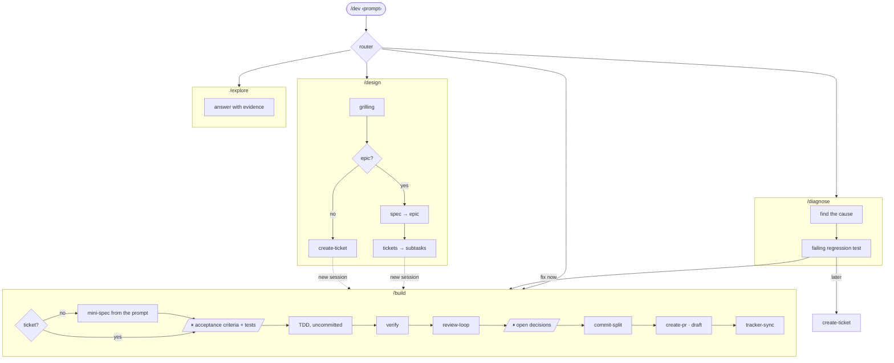

# agent-harness

A workflow for coding agents, from the first prompt to an open draft PR: a router, four flows, the skills they chain, and one place for the config they share. Built for [Claude Code](https://claude.com/claude-code) skills on top of [mattpocock/skills](https://github.com/mattpocock/skills).

## Why

A skill library leaves the human as the orchestrator: remembering which skill fits, invoking each one, reconciling the config every skill keeps on its own, and reading long reports between steps. This harness takes that role:

- **One entry point.** `/dev <prompt>` reads the prompt, picks the flow and runs it. Every flow can also be invoked directly.
- **Two checkpoints in a build.** The tests are approved before any code exists, and only the review's open decisions come back. Everything else runs on its own.
- **History written at the end.** The implementation stays uncommitted through TDD and review; `commit-split` then writes small single-purpose commits, tests before code.
- **One config.** Where tickets live, their templates, ids, branches, version control and commit conventions: every skill reads the same two files.
- **Overrides that survive updates.** A wrapper reads a third-party skill's `SKILL.md` and lists only its changes, so upstream improvements keep flowing in.

## Flows



| Flow | From | To |
|---|---|---|
| `/design` | an initiative or a plan | tickets in the tracker; the session ends there |
| `/diagnose` | something broken | the cause and a red regression test, handed to `/build` or left as a ticket |
| `/build` | a ticket or a concrete change | an open draft PR; a ticket is created first when there is none |
| `/explore` | a bounded question | an answer with `file:line` evidence |

## Skills

| Skill | Kind | Role |
|---|---|---|
| `dev` | own, user-invoked | router |
| `design`, `build`, `explore` | own | flows |
| `diagnose` | wraps `diagnosing-bugs` | stops at red and hands over |
| `grilling` | takes the place of `grilling` | assumed decisions in one block, at most three open questions per round; every skill that invokes `grilling` (`grill-with-docs`, `wayfinder`, `triage`) gets this version |
| `spec`, `tickets` | wrap `to-spec`, `to-tickets` | publish through the shared tracker config |
| `create-ticket` | own | one ticket from a need, a thread or a closed design |
| `commit-split` | own | uncommitted work → single-purpose commits |
| `review-loop` | own | review with a fresh `code-reviewer` agent, minimal fixes, only decisions come back |
| `pr-review` | own | review a teammate's PR in Conventional Comments |
| `create-pr` | own | PR from the branch's commits and a template |

`agents/code-reviewer.md` is the reviewer `review-loop` and `pr-review` dispatch.

`build` also invokes `tdd` (mattpocock) and `tracker-sync`, which are not part of this repo.

## Install

1. Install [mattpocock/skills](https://github.com/mattpocock/skills) with `npx skills`, so they live in `~/.agents/skills/`. The wrappers read them from there.
2. Link this repo's skills and agent:

   ```bash
   for s in skills/*; do ln -s "$PWD/$s" ~/.claude/skills/; done
   ln -s "$PWD/agents/code-reviewer.md" ~/.claude/agents/
   ```

3. Unlink from `~/.claude/skills/` the skills a wrapper replaces (`diagnosing-bugs`, `grilling`, `to-spec`, `to-tickets`; linking this repo's `grilling` takes its place) and the ones a flow replaces (`implement`, `code-review`, `ask-matt`), so they do not compete for the same prompts. They stay in `~/.agents/skills/` for the wrappers to read.

## Configure

Copy `config.example/` to `.config/` at the repo root and fill it in. `.config/` is gitignored: it holds your tracker ids, templates and conventions.

| File | Holds |
|---|---|
| `tracker.md` | the tracker adapter (operations: create, create child, block, start, read…), status lifecycle, title and body templates |
| `workflow.md` | ticket id and branch patterns, version-control commands, commit conventions, linters |

Skills find `.config/` two levels above their real directory, so the repo can live anywhere. Skills from mattpocock that read `docs/agents/issue-tracker.md` (`wayfinder`, `triage`) can share the same file through a symlink.

`create-pr` keeps its own preferences in `~/.claude/create-pr/preferences.md`; it runs a setup interview the first time.
